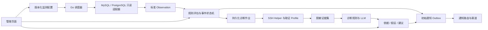

# 二期：可配置的业务监测与辅助诊断系统

方案日期：2026-10-09；状态更新：2026-10-10。本文保留二期初始方案及范围讨论，不能将所有计划项理解为已经实现。当前通用监测核心已交付，已实现能力及验证边界以 [二期验收](phase-2-validation.md) 为准。按当前安排，先以现有二期核心收口，后续增量采集、正式发布及生产建设等留待三期评估，暂不继续扩展。

## 1. 最终目标

在现有独立 Go 系统上演进出一套可复用的业务监测引擎：配置只读业务数据库查询、业务字段映射、异常与恢复规则、SSH 取证方式、诊断策略及通知路由，自动完成“观察业务 → 发现异常 → 采集日志 → 规则与 LLM 分析 → 通知及解决建议 → 人工处理 → 恢复跟踪”。

衡量复用性的方法是：接入表结构、业务键、状态和日志格式不同的新业务时，常见情况只需增加配置和运行手册，事件、调度、诊断和通知引擎不需要修改。确有复杂语义时允许添加小型 Go 业务适配器。

通用范围先覆盖两类监测：

- **业务记录监测**：异步作业、订单回调、数据同步记录、批处理任务等；检查状态、等待时长、进展和结果。
- **聚合指标监测**：最近时间窗口的失败数、积压数、失败率、最近一次成功时间等；SQL 返回带类型的数值结果。

现有招标解析成为一个示例业务包。第二个示例默认采用模拟订单回调/数据同步，使用不同表名、业务键和状态；最终以用户回复确定。两种示例同时运行，再增加一项聚合检查，避免只有接口而缺乏复用证明。

二期仍采用模块化单体、Go 后端与 Go Helper、本机 Docker Compose。交付自动监测和人工解决建议；自动执行修复、完整基础设施指标平台、分布式调度、多租户及插件市场不列为本期验收项目。

用户补充的部署目标：适合不同使用者拉取使用。用户端只需 Docker 与 Compose；提供固定版本的预构建镜像、演示/业务两种启动入口、Go 初始化工具、接入引导和升级恢复说明。部署便利性与跨业务复用性共同作为二期交付标准，详见第 10 节。

## 2. 当前源码的评估

### 可继续使用的基础

- Go 主服务、context 超时、有限诊断执行槽，以及分开的采集、诊断和通知循环。
- 增量游标、时间重叠窗口、活动对象复查和周期校对的实现思路。
- 三值判断、连续观察、事件指纹、持续异常去重、异常轮次和恢复跟踪。
- 人工关闭与业务恢复分离，关闭原因、审计及迟到诊断归档。
- PostgreSQL/GORM、事务 Outbox、持久化诊断作业和有限投递重试。
- SSH 签名、固定主机密钥、forced-command、读取限额、脱敏和证据 ID。
- 模型总时限、结构化响应与引用校验、失败回退，以及现有事件页面。

这些是可复用机制，不等于已经实现多数据源或通用业务配置。

### 必须改造的耦合

| 部分 | 当前事实与源码位置 | 二期目标 |
| --- | --- | --- |
| 数据库查询 | source.go:29 固定 async_tasks 和 biz_type='bidding'；:45 固定 bidding_results | Source 与 Check 分离，MySQL/PostgreSQL 连接、只读查询、参数和字段映射可配置 |
| 结果语义 | source.go:74 固定招标 JSON 路径及投标人须知字段 | 通用必要字段/数值检查；复杂招标摘要下沉至示例适配器 |
| 扫描编排 | collector.go:13 使用具体 *Source；:134 直接查询 MySQL UTC_TIMESTAMP | 引擎依赖数据源接口；游标、数据库时间与 SQL 方言由适配器提供 |
| 对象与规则 | rules.go:13 固定五种任务状态，规则列表和阈值写在 Go 中 | Entity、Observation、RuleSpec；触发与恢复表达式、确认次数、等级可配置 |
| 确认计数 | rules.go:66、:68 最大计数为 3 | 按实际配置上限计数，允许大于 3 次连续确认 |
| 事件身份 | model.go:113 使用 TaskID；events.go:51 等级 warning、版本 v1 | check_id、entity_key、rule_id，保存规则与配置版本、级别和标题 |
| SSH 与日志 | evidence.go:74 固定 lab-worker；:183、:186 固定模拟日志路径 | 主机、服务及取证 profile 注册，按业务关联字段查询 JSONL/文本日志 |
| 日志时效 | evidence.go:153 读取文件头部，之后选最后 N 条 | 在受限字节/时间预算内读取尾部并处理有限数量轮转文件 |
| 诊断内容 | diagnosis.go:136 固定 synthetic-provider；model_diagnosis.go:68 为售前专用提示词 | 可配置错误特征、原因类别、运行手册和通用诊断输入 |
| 通知 | events.go:32 固定 local_sink；outbox.go:57 使用一个 Sink，:72 要求 code=0 | 按路由选择多个 Channel，按渠道定义内容与确认协议 |
| 页面与接口 | main.tsx:18 起的标签和接口筛选以固定任务为中心 | 来源、检查、对象、规则和通知渠道的通用展示及配置管理 |
| 迁移 | store.go:29、:36 只认 001；:40 按分号拆 SQL | 有序版本迁移；升级执行新迁移，保留历史数据 |

另需解决：collector.go:67、:179 使终态任务持续到期复查，completed 对象逐个读取结果形成 N+1；cmd/bid-mon/main.go:83 的轮询周期包含本次执行耗时。二期应明确活动对象复查、终态退出、批量读取、扫描耗时与滞后，防止慢来源拖住其他检查。

## 3. 推荐 Go 技术栈

| 层次 | 推荐选择 | 实际用途及现有关系 |
| --- | --- | --- |
| Go 语言与并发 | 继续使用现有 Go 工具链，context、goroutine、有限 worker pool、slog | 限时、取消、并发隔离和结构化日志；开发时锁定受支持版本，不为二期顺带升级所有依赖 |
| HTTP/API | Gin | 新增配置、检查试运行与管理 API，统一鉴权、错误处理和请求日志；保留现有 net/http.Server 的超时与退出方式，业务层不依赖 gin.Context |
| 系统存储 | PostgreSQL + GORM | 存储配置版本、游标、观察状态、事件、证据、诊断作业、Outbox 与审计；延续现有实现 |
| 业务数据库 | database/sql + sqlx；MySQL 驱动、pgx/stdlib | 执行外部数据库显式只读查询、命名参数与动态结果映射，独立连接池；外部业务表不创建 GORM 模型 |
| 规则 | CEL-Go | 编译和执行状态、时长、数值、必要字段及组合条件表达式；附加应用层输入类型校验、表达式成本限制和 unknown 处理 |
| 配置 | YAML/JSON + 强类型 Go 配置结构 | 严格验证未知字段、引用、字段类型、表达式与查询预算；使用环境变量或文件 secret 引用 |
| SSH | golang.org/x/crypto/ssh + 自研 Go Helper | 继续受限取证，增加多主机与可配置 profile；客户端不传任意命令或路径 |
| LLM | net/http + ModelProvider 接口 | 先保留现有兼容接口适配器；业务诊断输入、模型配置和响应校验分层，按需要添加其他 provider |
| 通知 | Go HTTP 客户端 + Channel 接口 + PostgreSQL Outbox | 必做本地接收器与通用 Webhook；渠道凭据与管理登录凭据分开 |
| 自身可观测性 | slog + Prometheus client_golang | 暴露扫描时长/滞后、数据源错误、队列、模型回退、通知重试指标；任务或订单 ID 不作指标标签 |
| 前端与部署 | React/TypeScript/Vite/Tailwind、Go embed、Docker Compose | 延用页面与构建方式；正式运行配置与模拟示例分开 |
| 测试 | testing、httptest、race、真实数据库/SSH 集成与现有浏览器验收 | 新增配置契约和跨业务验收；模型确定性测试使用本地假服务，真实调用单独验收 |

Gin 的价值是路由分组和中间件组织，本身不带来业务复用；优先完成契约和配置，HTTP 迁移不作为第一阶段阻塞条件。[Gin 官方文档](https://gin-gonic.com/en/docs/middleware/)

sqlx 为 database/sql 提供结构/map 扫描和命名参数，适合配置驱动的外部查询；pgx 提供 database/sql 兼容适配器。[sqlx 项目说明](https://github.com/jmoiron/sqlx)、[pgx 项目说明](https://github.com/jackc/pgx)

CEL 支持对提供的变量进行表达式编译和类型检查，也提供执行成本限制；仍需限制输入大小及应用提供的函数。当前维护项目为 cel-expr/cel-go，当前模块路径以其 go.mod 的 cel.dev/cel-go 为准；实施时选择并锁定兼容版本。[CEL-Go 项目](https://github.com/cel-expr/cel-go)、[CEL API](https://pkg.go.dev/cel.dev/cel-go/cel)

YAML 解析采用维护中的 yaml/go-yaml，按选定版本确认实际模块路径；新规则使用配置文件，配置导入后生成不可变版本快照，不允许文件和页面各自维护一套冲突的活动配置。[YAML 维护项目](https://github.com/yaml/go-yaml)

Prometheus 可先只提供 /metrics，Prometheus/Grafana 作为可选部署 profile；Redis、Kafka、微服务拆分和 Kubernetes 不作为本期必需依赖。[Prometheus Go 接入说明](https://prometheus.io/docs/guides/go-application/)

## 4. 核心架构与接口边界



### 4.1 配置与对象

- **SourceDefinition**：连接 ID、驱动、secret 引用、连接池与查询预算。一个来源可有多个检查。
- **CheckDefinition**：稳定 ID、来源、实体/聚合模式、频率、查询及参数、字段映射、身份字段、规则、取证 profile、诊断与通知策略、版本。
- **Observation**：check_id、entity_key、observed_at、source_updated_at、类型明确的 fields、采集质量与未知原因。资源可以是订单、作业或聚合分组，无需统一为 Task。
- **RuleResult**：rule_id/version、triggered/clear/unknown、依据及严重等级；触发次数与恢复次数独立。
- **EvidenceRecord**：取证主机/服务/profile、关联对象、操作、采集时间、时间窗、脱敏内容、截断和不可用原因。
- **DiagnosisReport**：异常事实、确定性证据结论、LLM 假设、冲突、缺失证据、人工建议及版本。

entity_key 支持组合业务键。聚合检查使用“check + 业务分组”作为稳定对象身份，不按每次滚动时间窗口创建全新的事件。

### 4.2 小接口与模块组织

建议按职责逐步拆分现有 internal/monitor；每个接口服务于已存在的替换需求，避免先做插件框架。

```text
internal/
  domain/                 强类型观察、规则结果、事件、证据、报告
  config/                 导入、校验、不可变版本、secret 引用
  source/                 只读 SQL 适配器、字段映射、分页与游标
  scheduler/              每检查调度、执行预算、来源并发限制
  rules/                  CEL 与少量业务校验扩展
  incident/               去重、确认、关闭、恢复、审计
  evidence/               SSH 客户端、协议与 profile 校验
  diagnosis/              诊断规则、运行手册、LLM adapter、引用校验
  notification/           route、channel、renderer、Outbox
  repository/             PostgreSQL/GORM 与版本迁移
  api/                    HTTP DTO、鉴权与管理接口
examples/
  presales/               原业务配置、必要摘要适配器与模拟环境
  order-callback/         异构业务配置、日志样本与模拟环境
```

数据源暴露 Poll/Fetch 类接口，返回带质量状态的观察批次与游标；取证使用 EvidenceCollector；诊断使用 Diagnoser/ModelProvider；通知使用 Channel。配置和存储结构不直接暴露为 API 请求对象。

## 5. 二期必须补齐的行为

### 5.1 数据采集与调度

1. 每个来源独立连接池、每个检查独立游标和健康状态；慢来源、查询错误不阻塞其他来源。
2. SQL 模板由管理员配置，业务值使用绑定参数；提供查询试运行、字段类型预览、结果大小及耗时检查。
3. 业务库使用最小只读权限、查询超时、行数/字节预算及数据库侧限制；简单检查 SELECT 字符串不能作为安全保障，限制多语句与副作用调用。
4. 有可靠 updated_at 时使用时间+稳定 ID 增量分页，并保留重叠和校准；无可靠更新时间时显式使用有预算的全量/聚合查询。
5. 活动异常复查优先；无异常终态对象退出高频轮询。保留恢复所需状态，历史观察/证据按明确策略过期，不依赖无上限增长。
6. 多表结果优先批量/联合查询，复杂情况允许适配器；不强迫所有业务使用相同任务/结果表。
7. 单检查禁止重入，设置超时、抖动及公平并发预算；二期继续单领导进程，记录计划时间、实际时间、耗时与滞后。

### 5.2 配置规则与事件

首先提供状态异常、等待超时、进展停滞、关联结果缺失、必要字段检查、数值阈值及组合表达式。招标结构校验放到业务适配器，不能用一个“空字段规则”替代已有完整判断。

字段类型错误、查询失败、时间戳非法、分页截断、表达式执行错误均返回 unknown。成功查询零行也不自动表示既有事件恢复；使用对象详情复查或配置明确的“消失语义”。聚合 COUNT 返回合法 0 时才按数值规则处理。

每个规则独立声明触发条件与恢复条件、防抖次数、宽限期和等级。规则版本改变时重置不适用的确认计数，历史报告保留原定义；修改标题/通知目标不应制造新的异常轮次。暂停检查只改变监测状态，不表示业务恢复。

事件指纹包含稳定 check_id、entity_key、rule_id 与环境。保留原业务历史身份映射，避免升级后持续异常重新发一轮初始告警。

### 5.3 通用 SSH Helper

两端分别维护主机、服务及取证 profile 的允许清单。请求传 profile ID、关联字段、时间窗和限额，目标 Helper 把它解析到管理员预配置的日志位置；客户端和 LLM 不传任意路径或 Shell 命令。

必做 JSONL 与带时间戳的普通文本日志，profile 指定时间解析方式和关联字段。读取目标端允许目录中的尾部/轮转日志，保留文件边界限制，最多读取预算内字节和文件数，超出时明确截断；不声称有限读取覆盖了全部日志。

把 task_id 换成通用关联键和 profile 选择器，允许订单 ID/批次号/请求 ID；来源与身份同时绑定主机、服务和检查，避免两个业务的同名 ID 混入同一证据集。心跳路径、格式和有效期也由 profile 定义。

首期日志以文件访问为主；仅有 Docker stdout/journald 的系统，需单独实现并配置受限读取方式或日志导出，不能把当前模拟 JSONL Helper 宣称为已经支持任意容器日志。

### 5.4 规则与 LLM 判断

分清两个阶段：

- **异常判定**：依据业务观察和明确规则决定是否建事件、是否解除；保存当次输入、规则版本和触发依据。
- **原因诊断**：诊断规则匹配日志特征，LLM 综合日志、业务状态和运行手册，输出原因假设、证据引用、缺失信息及人工处置建议。

先支持 rule_only 与 hybrid 两种诊断策略。LLM 可以判断未知错误的可能类别、证据冲突和排查优先级，不受售前固定类别限制；模型结论以 hypothesis 展示，不能覆盖明确规则事实或擅自确认恢复。

若业务确需 LLM 判断语义异常，再增加显式 opt-in 的 llm_review 检查：由廉价规则筛选候选，以独立预算调用模型，结果只能是疑似异常/未见异常/不确定；调用失败不能当作业务正常。这属于后续增强，不作为第一批通用闭环的前置条件。

继续保留结构化输出、证据白名单、输入截断、脱敏、总时限、并发限制与回退。引用校验只证明 ID 存在，不能证明模型解释正确；用固定证据样本测试冲突、注入、未知错误、无依据推断和幻觉。

建议包含“检查对象、具体检查步骤、如何解释结果、下一步”，区分低风险检查与可能影响业务的处置。运行手册可引用，系统本期不执行处置。

模型外发需按来源设置 allow_model、允许字段和脱敏策略；现有授权覆盖合成证据，不能自动扩展到真实客户数据。

### 5.5 通知、页面及运维

1. 必做 Local Sink 与 Generic Webhook；路由按来源、检查、严重级别选择一至多个 destination，并支持 initial/diagnosis/recovered/closed 内容模板。
2. Channel 单独处理鉴权和送达确认协议。通用 Webhook 可以约定 2xx；Local Sink 保留 code=0 协议。飞书等渠道有具体需求与测试条件再添加。
3. Outbox 按 event/revision/destination 保留唯一性和重试状态；同一渠道保持顺序，不让一个失败渠道阻塞其他渠道。网络送达存在不确定性，传递稳定幂等键供接收端去重。
4. 页面从单一任务列表变为来源/检查/对象中心：展示连接测试、检查启停、规则预览、取证试运行、事件、报告、关闭原因和渠道投递记录。
5. 配置提供导入、验证、启用、版本及回退；文件导入与页面调用同一套配置服务。测试连接与试运行应标记为 dry run，不建立正式事件或发送通知。
6. 通知记录以本系统 Outbox/渠道确认记录为依据，不要求远端机器人提供通知列表 API。
7. 增加请求/检查/作业关联日志、/metrics、存储与配置就绪状态及各来源健康；一个来源失败显示 degraded，不把整个服务的存活与业务数据库健康混为一谈。
8. 有序数据库迁移、配置 secret 脱敏、Docker 运行环境与模拟示例分离，补充源码打包和 Git/CI 基线，依赖缓存不作为交付源码。

## 6. 配置示意

以下仅解释拟定契约，不是当前程序可读取的配置。查询语法和参数应随驱动选择；年龄计算及字段类型需要由适配器校验。

```yaml
sources:
  - id: orders-db
    driver: mysql
    dsn_secret: env:ORDERS_READONLY_DSN

checks:
  - id: order-callback-delay
    source: orders-db
    mode: entity
    interval: 15s
    query_file: queries/mysql/order_callbacks.sql
    identity_fields: [order_id]
    fields:
      callback_state: {column: notify_state, type: string}
      age_seconds: {column: age_seconds, type: int}
      updated_at: {column: modified_at, type: timestamp}
    rules:
      - id: callback-abnormal
        severity: warning
        trigger: "row.callback_state == 'FAILED' || (row.callback_state == 'WAITING' && row.age_seconds > 300)"
        recover: "row.callback_state == 'DELIVERED'"
        trigger_observations: 2
        recover_observations: 2
    evidence_profile: order-callback-logs
    diagnosis:
      mode: hybrid
      runbook: runbooks/order-callback.md
      timeout: 120s
      allow_model: true  # 示例仅用于模拟数据
    notification_routes: [order-operators]
```

改成另一个业务，通常替换来源、查询、字段映射、规则、取证 profile 和运行手册；引擎继续使用同一套代码。SQL 文件仍需具备分页/复查等契约，不能把任何一条任意 SQL 直接视为完整可靠的增量监测配置。

## 7. 实施顺序与交付

| 阶段 | 必须产物 | 验收关口 |
| --- | --- | --- |
| 0：建立简单部署入口，与 A 并行 | 标准 Compose、演示分离、Go 初始化/校验、开发与发布镜像分开 | 全新目录只依赖 Docker/Compose，可完成初始化和启动；不依赖宿主 Python |
| A：抽出契约并保留首期行为 | 强类型通用对象、小接口、版本迁移；原业务封装为示例适配器 | 原业务既有场景仍通过，历史关闭状态、事件身份与游标未丢失 |
| B：配置驱动的采集与规则 | 配置校验、MySQL/PostgreSQL、多检查调度、字段映射、CEL、试运行 | 新订单业务仅增加配置接入；实体与聚合检查能工作，坏来源不拖住好来源 |
| C：取证与诊断通用化 | 多主机/profile、尾部/轮转日志、通用诊断规则/运行手册、hybrid LLM | 两业务同名 ID 不串证据；最新日志可取；模型失败有规则报告与初始通知 |
| D：路由及管理能力 | 多渠道 Outbox、Webhook、本地接收器、来源/检查/规则/投递页面 | 双渠道投递互不阻塞；可预览、启停、关闭、追溯，不依赖远端通知查询 API |
| E：复用验收与交付 | 两业务示例、聚合检查、故障测试、可观测性、数据保留、运行与接入文档 | 第三个检查无需修改核心；重启保留状态；独立 Docker 一键运行 |

最先开发 0+A+B，得到“他人可启动并通过配置接入第二个业务”的可运行结果；再扩展取证和渠道。Gin 迁移、目录调整与命名修改随模块开发进行，不单独花一个阶段只搬文件。镜像发布与跨平台安装验证在最终交付阶段完成，发布目的地须由项目维护者确定。

首批必做：多检查/两类来源、多业务对象、可配置规则、多主机受限日志、规则与 LLM 诊断、通用 Webhook、页面管理、有序迁移、跨业务验收及简易部署发布包。飞书、更多数据库、纯 LLM 语义检查、OIDC/RBAC、分布式部署和自动修复按实际需求后续安排。

## 8. 二期完成标准

1. 同一 Go 服务同时监测原招标示例与新订单/同步示例，表、状态和日志关联字段不同；新场景通过配置和示例数据接入，不修改事件/通知/诊断引擎。
2. 只读 MySQL 与 PostgreSQL 都经过真实集成测试；实体规则与至少一个聚合阈值检查均有正常、异常和恢复样本。
3. 同时间戳分页、重复扫描、晚到更新、数据源失败、空结果、字段错误和查询截断均有明确行为；unknown 不计为恢复。
4. 连续确认数可配置大于 3；触发/恢复条件独立，修改规则与暂停检查不会伪造业务恢复。
5. 两来源/两主机出现同名对象 ID 不串事件、不串日志、不串通知；配置版本与报告可追溯。
6. 大日志的最新错误能在预算内取得，轮转与截断有标志；路径越界、未注册服务、无效签名和主机密钥变化会拒绝取证。
7. 诊断规则匹配已知错误；LLM 对未知错误可给出有证据的假设；超时、坏格式、伪造引用和注入文本有明确回退，不伪装模型成功。
8. 一渠道失败不会堵塞另一个；重试、幂等键、有限预算、人工关闭后通知抑制均通过测试。
9. 重启保留检查版本、游标、活动事件、关闭原因与投递状态；升级可从首期数据库迁移，迁移失败不清库。
10. 页面能完成连接/检查预览、启停、看证据及原因、查看投递并填写原因关闭。管理权限先保留单管理员，远程部署再按实际需要增强。
11. 提供系统自身指标与明确的 retention 配置；固定负载实验至少覆盖目标数据量、扫描滞后、查询预算和通知故障，记录样本条件，不沿用首期实验数字冒充二期性能结果。
12. 正式运行路径只需 Go 服务、系统 PostgreSQL、配置与必要凭据；模拟数据库、Python 模拟器和本地接收器可以作为独立示例启动。无需 Akmatori 服务。
13. 新用户在干净目录使用发布包，仅安装 Docker/Compose 即可初始化并启动；无需宿主 Python、Go、Node 或 npm，不要求用户本地编译镜像。
14. 默认业务部署不依赖模拟 MySQL、Worker、SSH 目标或通知接收器；首次启动可先登录配置，尚无检查时就绪，不因未填写业务 DSN/SSH/模型参数陷入重启。
15. 演示与业务配置隔离；不同安装实例不会复用维护者密钥，重复初始化保留已有设置；发布包不包含本机 .env、模型密钥、缓存或 Docker 数据卷。
16. Linux amd64 与 arm64 运行镜像、Linux Helper 发布物均通过对应架构启动/协议测试；Windows/macOS 使用 Docker Linux 容器，说明并验证启动脚本和路径挂载。
17. 能在页面完成首次管理员登录、接入检测和检查试运行；错误能说明配置项及处理步骤，未配置模型时仍可用规则诊断。
18. 升级演练包含配置及系统库备份、版本迁移、重启与恢复；验证数据库兼容性，不将旧镜像启动当作必然成功的回滚。

## 9. 本轮审查及待定项

本轮是静态源码与技术文档审查，未重新运行首期测试、未改动业务实现。已有验收结果见 go-validation.md；它们证明首期业务闭环，不能证明二期通用能力。

推荐默认决策：单体 Go 服务、配置驱动、MySQL/PostgreSQL、实体+聚合、Linux Go Helper、rule_only/hybrid、Webhook+本地渠道、单管理员、Docker Compose。没有真实渠道时用本地假服务验收 HTTP 契约，真实送达另行验证。

第二业务已采用订单回调，实体与聚合检查均已完成本机闭环验收。2026-10-10 当前实现及仍未完成的发布/分页/跨平台事项见 [二期验收记录](phase-2-validation.md)。用户已选择关闭自动数据清理，仅提供保留预览。

## 10. 简单部署与多人使用的交付方案

### 10.1 当前部署的限制

- deploy/compose.go.yml 面向本机实验，monitor 默认依赖模拟 MySQL、ssh-target、notification-sink；正式用户很难只启动监测服务并接入自己的系统。
- 模拟镜像使用 pull_policy: never，主服务也默认从源码构建；Go/Node 构建在 Docker 内，但首次使用仍需下载构建依赖并完成本地构建。
- scripts/init_lab.py 要求宿主 Python 生成 .env；scripts/init_evidence.py 在初始化容器中依赖 Python/cryptography，只为生成密钥和配置权限。
- 配置依赖单一来源、固定本机端口和 SSH 挂载路径；页面缺乏新安装实例的接入引导。

二期按“普通使用者拿到发布包即可运行，开发者才从源码构建”的方式组织交付。

### 10.2 两种清晰入口

| 模式 | 启动内容 | 使用者需要提供什么 |
| --- | --- | --- |
| 演示模式 | Go 主服务、系统 PostgreSQL、模拟业务、模拟日志/SSH、本地通知接收器 | 安装 Docker/Compose；模型默认关闭，可自行选择启用 |
| 业务模式 | Go 主服务、系统 PostgreSQL；可选使用已有系统数据库 | 管理员首次登录后配置业务库只读连接、规则、日志目标及通知；模型可选 |

以正式运行 Compose 为基础，模拟服务放入 demo profile 或独立 demo override；开发构建另用 dev override。核心 monitor 不声明对模拟服务的强制依赖。Compose profiles 用于有选择地启动辅助服务。[Docker Compose profiles](https://docs.docker.com/compose/how-tos/profiles/)

业务模式在没有任何监测定义时也能正常启动，提供配置页面。存在活动检查后，业务源不通应显示该来源异常，服务仍允许管理员登录修正配置。

### 10.3 发布包与预构建镜像

维护者构建并发布固定版本，例如 v2.0.0（仅为计划中的版本示意）；普通用户拉取对应镜像。发布包包含：

- compose.yaml、示例配置、.env.example、版本/镜像清单与校验和。
- Windows start.ps1 与 Linux/macOS start.sh，统一调用初始化和 Compose；保留等价手工步骤便于排查。
- 快速开始、业务接入、SSH Helper 安装、升级、备份恢复及故障说明。
- Linux amd64/arm64 的 Helper 与安装配置模板。

镜像包含已构建前端和 Go 后端；使用固定版本标签并记录镜像 digest，升级由使用者主动选择。使用 Docker Buildx 构建 linux/amd64 与 linux/arm64 镜像并进行运行验证，多架构 manifest 可让 Docker 根据宿主架构选择镜像。[Docker 多平台构建](https://docs.docker.com/build/building/multi-platform/)

镜像仓库可采用 GHCR 或维护者指定的仓库；公开发行时确认镜像可匿名拉取，内部发行时说明仓库登录方式。仓库地址可替换，并可补充离线镜像包，不把用户锁定在一个网络目的地。GHCR 的镜像与访问控制机制见[GitHub Container Registry 文档](https://docs.github.com/en/packages/working-with-a-github-packages-registry/working-with-the-container-registry)。当前没有实际发布镜像或创建公开仓库。

源码仓库/标准源码 ZIP 仅包含代码、模板及文档；完整本机备份另作个人备份，不用于分发给其他使用者。尤其不包含 deploy/.env、model.local.json、历史证据、node_modules、.venv 与缓存。

### 10.4 用 Go 完成初始化与校验

增加独立于业务配置加载的 CLI 子命令，初次运行无需先具备业务数据库 DSN：

- **init**：生成当前安装实例的管理员凭据、系统库凭据及示例配置，选择业务/演示模式；只创建缺失文件，不自动重置已有凭据。
- **config validate**：严格验证配置结构、引用、字段类型、规则、secret 引用和版本兼容性，不建立正式事件。
- **doctor**：说明端口、配置挂载、系统库、业务连接、SSH 主机密钥/协议及通知测试的结果；带开关的通知测试明确标记为测试投递，模型测试仅由用户显式触发。
- **migrate**：执行有序迁移，提供错误状态和失败恢复说明；不因初始化或升级失败清库。

初始化在一次性 Go 工具容器中执行，包装脚本检查 Docker/Compose/端口及目录访问，完成初始化后拉取并启动对应服务。初始化 Compose 应单独可执行，不引用尚未生成的必填 .env 值，避免启动前置依赖循环。

演示 SSH 密钥、签名密钥、known_hosts 与目录权限由 Go 初始化代码生成，替换当前 Python 初始化容器；真实目标使用其已有主机指纹，不套用演示目标名称或密钥。

管理员凭据写入本机受限文件，通过页面登录；终端显示凭据文件位置与打开地址，常规日志不打印密钥。需要共享访问时使用独立管理员凭据或后续用户机制，不把开发者本机凭据复制给使用者。

重复运行初始化、重启和升级均保留配置与密钥。Docker 使用命名卷保存系统数据库；实例名称、HTTP 端口可设置，同一宿主的不同实例隔离网络、数据卷和凭据。

### 10.5 首次接入引导

第一次进入页面，按业务步骤完成：

1. 添加业务数据库只读连接并测试；说明容器中的 localhost 与用户宿主/远端地址的区别，提供 Linux 与 Docker Desktop 对应示例。
2. 选择实体或聚合模板，填写查询与字段映射，查看样本和类型。
3. 设置触发/恢复规则，先做 dry run；展示为什么会触发，不立即通知。
4. 选择日志服务、主机与取证 profile，测试关联对象的日志采集；暂未配置 SSH 时仍可监测数据库，诊断明确说明缺失日志。
5. 添加通知目标并由用户触发测试消息；有需要再添加模型渠道。
6. 启用检查，查看首次运行和异常处理页面。

页面引导调用已有配置服务，YAML 导入/导出使用相同版本机制，避免维护两套配置。预置模板包含异步作业、订单回调及聚合阈值，并提供运行手册示例。

### 10.6 SSH 目标端的安装边界

运行监测服务与配置目标服务器是两个步骤。用户有目标服务器权限后，按安装包说明完成：

- 安装对应架构的 Go Helper，建立受限账号，配置 forced-command 和日志读取权限。
- 登记主机密钥、服务 profile 与签名配置；每个安装实例独立生成身份和绑定密钥。
- 用 dry run 显示拟配置内容，保留已有 sshd 设置及密钥，变更前备份；验证 SSH 配置后才应用。
- 从监测页面测试协议版本与采集，明确拒绝原因；不自动获得目标服务器管理员权限。

Helper 首批支持 Linux amd64/arm64，Windows/macOS 可作为监测客户端宿主。仅有容器标准输出的业务按支持的日志导出/受限采集方式配置，不能承诺无需目标端设置。

### 10.7 更新、备份与跨平台验收

更新流程固定为：确认目标版本 → 备份系统数据库及配置/必要凭据 → 拉取镜像 → 执行迁移并启动 → 检查就绪和活动检查。迁移需要保留已有事件、关闭原因、游标及通知状态。

数据库备份/恢复使用与系统库版本兼容的 PostgreSQL 工具容器，提供 pg_dump/pg_restore 操作入口；Go scratch 运行镜像不包含这些工具。恢复演练暂停后台投递并核对 Outbox 状态，明确恢复旧备份可能重新产生已送达但尚未记录的通知，继续通过稳定幂等键降低重复影响。

尽量采用向后兼容的增量迁移。若新 schema 不兼容旧镜像，回滚需恢复对应数据库备份与配置；提供实测恢复步骤。日常停止与更新不删除卷，清空数据使用独立明确操作。

发布验收覆盖干净目录与无宿主开发工具的环境、Windows PowerShell/Linux/macOS 脚本、amd64/arm64 镜像、重复初始化、端口冲突、镜像下载失败、配置错误、模型关闭、仅数据库监测、升级和备份恢复。文档区分“已验证平台”与“计划支持平台”，没有运行条件的平台不能标为已验证。

部署验收以操作次数、必要依赖和实际成功启动为准；启动耗时需记录机器与网络条件，不承诺任意网络都能在固定分钟数内拉取完成。
