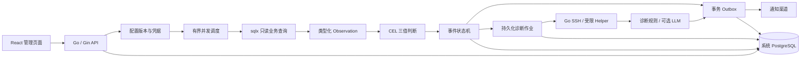

# bid_mon 项目导读与源码阅读路线

本文对应二期核心版本 `2.0.0-dev`。项目以本期已实现的功能收口；生产部署、通用增量采集及多人权限等后续建设保留为三期讨论。具体测试证据见 [二期验收](phase-2-validation.md)。

## 1. 这个项目解决什么问题

异步任务、订单回调、数据同步等业务通常把执行状态保存在业务数据库，把错误原因记录在服务日志里。任务失败或长时间不推进时，人员需要先查数据库找对象，再登录服务器查日志，最后把处理过程记录到其他地方。

bid_mon 把这些步骤连接起来：周期观察业务记录，按明确规则发现异常，记录事件并采集关联日志，给出有证据的诊断及人工建议，发送通知，再跟踪人工关闭和业务恢复。

首期针对招标解析任务。二期把来源、SQL、字段映射、触发/恢复规则、日志 profile 和通知渠道变成配置，并使用订单回调证明另一种业务可以接入同一引擎。它是独立 Go 项目，借鉴 Akmatori 的技术选择与设计思路；[借鉴说明](akmatori-reference.md)记录具体边界。

适用范围是数据库驱动的业务监测。当前支持 MySQL/PostgreSQL 实体记录和单行聚合检查；核心不是 CPU、网络、主机指标采集平台。

## 2. 架构和技术栈

| 技术 | 在本项目中的职责 |
| --- | --- |
| Go、context、goroutine | 服务入口、后台循环、并发限制、超时和停止 |
| Gin + net/http | API 路由与异常恢复；HTTP 服务超时；模型及 Webhook 客户端 |
| database/sql + sqlx | 外部 MySQL/PostgreSQL 查询、命名参数、动态行读取及连接池 |
| GORM + PostgreSQL | 系统事件、快照、作业、通知、审计、配置及凭据存储 |
| CEL-Go | 编译和执行可配置的触发及恢复表达式 |
| Go SSH + Go Helper | 核验主机身份，执行固定取证协议，读取授权日志 |
| AES-GCM | 加密系统库中的连接凭据；主密钥单独保存在实例文件中 |
| Prometheus client_golang | 暴露服务自身指标；当前指标集合仍较基础 |
| React + TypeScript + Vite + Tailwind | 管理页面；构建产物由 Go embed 提供 |
| Docker Compose | 运行、初始化、演示和集成测试环境 |

业务数据库和系统数据库职责不同：前者属于被观察业务，只读；后者属于监测系统，记录自己的运行状态。GORM 不负责修改外部业务表。

部署采用模块化单体。后台扫描、诊断、通知是同一个 Go 进程里的不同循环，通过 PostgreSQL 中的持久状态衔接。业务模式运行 Go 和 PostgreSQL 两个容器；演示额外启用模拟业务、Worker、MySQL、SSH 目标和通知接收器。

Python 代码用于模拟业务和验收工具；核心引擎及远端 Helper 均为 Go。前端构建后无需独立 Node 服务。

## 3. 配置里的概念

| 概念 | 含义 | 订单示例 |
| --- | --- | --- |
| Source | 驱动、只读连接凭据引用、查询预算 | orders / MySQL |
| Check | 周期、SQL、模式、字段、规则、取证和通知 | order_callback |
| Entity | 一个稳定业务对象 | order-001 |
| Observation | 某次查询得到的类型化字段及质量状态 | status、retries、age_seconds |
| Rule | 显式触发与恢复条件、确认次数、严重等级 | WAITING_ACK 等待超过 300 秒 |
| Event | 某对象某规则的一轮持续异常 | 一个打开的回调超时事件 |
| Evidence | 绑定事件、对象和时间窗的快照、日志或详情 | 数据库快照、关联日志 |
| Diagnosis | 事实、原因假设、缺失证据、人工建议 | 下游超时，检查接口响应 |
| Channel | 通知目标、凭据引用、确认协议 | Webhook |

最容易混淆的是 Rule 和 DiagnosticRule：前者根据业务字段发现异常或确认恢复；后者根据证据内容匹配原因及处理建议。LLM 是可选诊断补充，不改写规则事实或业务恢复状态。

`identity` 指向映射字段，组成稳定业务键。相同对象在不同检查中有独立身份。接入完全不同的业务应使用新的 check_id，不应随意复用旧检查编号。

初始文件只负责空安装引导。页面保存后会生成配置版本并激活；重启优先加载系统库中的活动版本。修改文件并不等于覆盖已经激活的数据库配置。凭据使用环境变量、文件或 `stored:<id>` 引用，不写入共享配置。

## 4. 按一条订单理解完整流程

以 [演示配置](../deploy/phase2/demo.template.json) 的 order_callback 为例，轮询间隔为 3 秒，超时规则触发和恢复均需连续两次观察。

1. 初始化生成实例凭据、master.key 和配置。Go 启动时连接系统 PostgreSQL、执行有序迁移、取得单实例运行锁、加载活动配置并编译 CEL。
2. 调度器选择到期检查，最多同时运行四个检查；不同来源交错执行，每次查询受自己的时间、行数和字节预算约束。
3. sqlx 在只读事务中查询订单。字段映射把数据库列转换为 string、int、timestamp 等类型，形成 Observation。超预算或查询失败丢弃查询批次，不把截断结果作为完整观察。
4. 假设订单处于 WAITING_ACK，age_seconds 为 360。CEL 触发表达式为 true，恢复表达式为 false，首次累计 bad=1；第二次仍满足时达到 bad=2。
5. 一个数据库事务创建 Event、审计记录和 initial Outbox。持续观察到同一异常时更新当前事件，不反复创建事件。
6. 通知循环从 Outbox 投递初始告警。诊断准备循环独立创建 Job；初始通知无需等待 SSH 或 LLM 完成。
7. 诊断读取事件快照，并根据事件保存的定义获取关联日志及可选详情 SQL。Helper 只接受授权对象、profile、操作和时间窗；不能执行任意 Shell。
8. 诊断规则发现 callback_timeout 时形成有证据引用的原因假设和建议。只有配置模型、hybrid 和 allow_model 同时满足时才调用模型；失败则保留规则报告。
9. 保存报告、证据和报告哈希，追加 diagnosis 通知。页面可以查看业务事实、报告、投递记录和事件审计。
10. 订单变为 DELIVERED 后连续两次满足恢复条件，事件标记 resolved，condition_active=false，并写入恢复通知。之后同一规则再次触发时建立新的事件，episode 增加。

轮询间隔是调度目标，不是端到端时延保证。实际发现时间还包括查询耗时、连续确认和调度等待；通知及诊断又有独立耗时。

## 5. 为什么人工关闭不等于恢复

事件有两个不同维度：status 表示工作事件是否待处理，condition_active 表示业务异常是否仍持续。

| 操作或观察 | status | condition_active | 结果 |
| --- | --- | --- | --- |
| 连续触发达到阈值 | open | true | 建立事件和初始通知 |
| 持续异常 | open | true | 更新当前事件，不重复创建 |
| 填写原因人工关闭 | closed_unresolved | true | 结束本轮人工处理，保留异常事实 |
| 人工关闭后持续异常 | closed_unresolved | true | 不重开事件 |
| 打开事件明确恢复 | resolved | false | 恢复通知 |
| 人工关闭事件明确恢复 | closed_unresolved | false | 保留关闭原因，确认本轮条件解除 |
| 条件解除后再次异常 | 新事件 open | true | 新 episode |

例如“这是实验故意制造的失败，不需要继续处理”，应填写原因关闭。系统不能因此把订单状态当作 DELIVERED。

规则判断还有 unknown：缺字段、类型错误、表达式失败、触发与恢复冲突、两者都不满足时，不能确认恢复。查询失败或对象消失会打断连续计数，也不会自动解除活动事件。

## 6. 持久化数据和异步可靠性

| 表 | 保存内容 |
| --- | --- |
| task_snapshots | 最近观察、类型化字段的脱敏快照、连续计数；名称沿用首期 |
| monitor_events | 事件身份、轮次、状态、活动条件、关闭原因、规则和配置定义 |
| diagnosis_jobs | 作业状态、原始截止时间、执行凭证、证据及报告 |
| delivery_outbox | 每事件版本与渠道的投递状态、次数、下次时间和确认时间 |
| event_audit | 打开、诊断、人工关闭、条件解除等记录 |
| monitor_config_versions | 不可变配置内容、版本、创建信息和激活状态 |
| monitor_secrets | AES-GCM 加密凭据 |
| monitor_cursors | 首期专用采集器的游标及健康；通用采集尚不使用增量游标 |

事务 Outbox 的目的：事件成功保存时，同时保存“需要发通知”的意图。网络发送不放在这个事务里，避免数据库提交和外部通知互相等待。发送后记录确认；失败有限重试，耗尽后 needs_attention。

幂等键由 event_id、revision、destination 组成，供接收端去重。同一事件同一渠道按版本顺序投递；一个失败渠道不会无限阻挡其他渠道。网络仍可能出现“对方收到，但本系统没有收到确认”，因此不承诺严格一次送达。

诊断默认两个执行槽，总预算 120 秒并包括排队，重启保留原截止时间。迟到结果不能取消人工关闭或重新发出诊断告警。关闭事件会取消待处理作业及旧通知，再记录关闭通知。

## 7. 源码怎么读

不要先逐行读完所有文件。先跟一条检查从配置进入事件，再读诊断和通知。

| 顺序 | 文件 | 阅读重点 |
| --- | --- | --- |
| 1 | [cmd/bid-mon/main.go](../cmd/bid-mon/main.go) | 初始化命令、迁移、运行锁、后台循环、HTTP、停止 |
| 2 | [internal/checks/types.go](../internal/checks/types.go) | Source、Check、Field、Rule、Observation 契约 |
| 3 | [internal/checks/config.go](../internal/checks/config.go) | 严格解析、默认值、引用检查、预算 |
| 4 | [internal/checks/sql.go](../internal/checks/sql.go) | 参数绑定、只读事务、完整结果边界、类型映射 |
| 5 | [internal/checks/rules.go](../internal/checks/rules.go) | CEL 编译、成本限制、三值判断 |
| 6 | [internal/monitor/general.go](../internal/monitor/general.go) | 到期调度、查询、previous、连续计数、配置版本 |
| 7 | [internal/monitor/events.go](../internal/monitor/events.go) | applyConfigured、enqueue、CloseEvent、去重与恢复 |
| 8 | [internal/monitor/diagnosis.go](../internal/monitor/diagnosis.go) | Prepare、RunOne、Finish、截止时间与迟到结果 |
| 9 | [internal/monitor/general_diagnosis.go](../internal/monitor/general_diagnosis.go) | 通用证据、原因匹配、手册和报告 |
| 10 | [internal/monitor/ssh_profiles.go](../internal/monitor/ssh_profiles.go) / [internal/evidence/profiles.go](../internal/evidence/profiles.go) | 客户端绑定与远端受限日志读取 |
| 11 | [internal/monitor/model_diagnosis.go](../internal/monitor/model_diagnosis.go) | 模型输入、超时、脱敏、结构化响应、引用与回退 |
| 12 | [internal/monitor/outbox.go](../internal/monitor/outbox.go) | 领取通知、发送确认、退避、失败状态 |
| 13 | [internal/monitor/http.go](../internal/monitor/http.go) / [general_http.go](../internal/monitor/general_http.go) | 登录、事件、配置、预览、凭据、保留预览 |
| 14 | [web/src/main.tsx](../web/src/main.tsx) | 页面如何调用管理 API，展示配置、事件和报告 |

辅助文件：model.go 定义系统模型；store.go 执行迁移和运行锁；secrets.go 管理加密；bootstrap 包初始化安装；cmd/evidence-helper 是远端入口；webui/embed.go 将页面嵌入 Go。

collector.go、source.go、rules.go 是保留的首期售前适配器。理解二期时先读 general.go 和 checks 包，再对照专用适配器；避免把首期硬编码规则理解成通用引擎限制。

测试也可以当作行为说明：general_integration_test.go 看事件闭环；general_http_test.go 看配置与凭据；ssh_profiles_test.go 看日志绑定；model_diagnosis_test.go 看坏响应回退；migration_upgrade_test.go 看历史记录升级。测试带 Integration 的场景依赖明确测试环境，不要指向真实业务系统。

## 8. 如何自己验证理解

在独立目录启动 demo，依次观察：正常订单没有事件；超时或 DEAD_LETTER 达到确认次数后建立事件；日志出现对应错误及诊断；通知得到确认；填写原因关闭后持续失败不重开；明确恢复后再次失败生成新轮次。

随后仅修改配置接入另一种表结构：选择稳定业务键、映射状态及时间字段、设置触发和恢复条件、配置日志关联字段，再执行连接检测、SQL/规则预览、取证预览和通知测试，最后保存激活。预览不会创建正式事件或投递正式告警；渠道测试会发送明确的测试消息。

应该能够回答这些问题：

- 业务库和系统库为什么分开？
- 触发、恢复和 unknown 各代表什么？
- 同一异常为什么不会每次轮询都新建事件？
- 人工关闭后业务还失败，系统为什么不重开？
- 事件保存成功但通知网络失败，如何补偿？
- SSH 或模型失败，初始告警是否仍能发送？
- 新业务需要改哪些配置，哪些核心代码可以继续复用？

## 9. 当前版本的边界

二期核心已通过 185 项 Go 测试（包含子测试）、14 项 Docker 业务闭环和 11 项页面验证。不是所有场景都由真实外部服务验收：二期模型使用本地模拟契约验证，企业通知使用本地接收器验证。

当前通用 SQL 为有预算的完整快照；window 参数不能自动提供增量、晚到回补或无限容量。出现结果超限需缩小查询或后续开发分页。查询窗口也要覆盖持续异常，否则旧对象可能移出观察范围；消失不会被误判为恢复。

运行锁保证同一系统库只运行一个主服务；当前没有多实例高可用。管理员使用实例凭据登录，尚未实现个人账号/RBAC。Helper 安装及 profile 配置仍需要人工完成。公开镜像、多平台实启、跨版本备份恢复演练等见验收文档剩余项。

自动清理关闭，仅提供 COUNT 预览；系统提供人工建议，当前不自动修改业务或执行修复。真实业务的模型数据范围由接入者另行确定。

能够清楚说明这些边界，也是理解项目的一部分。
